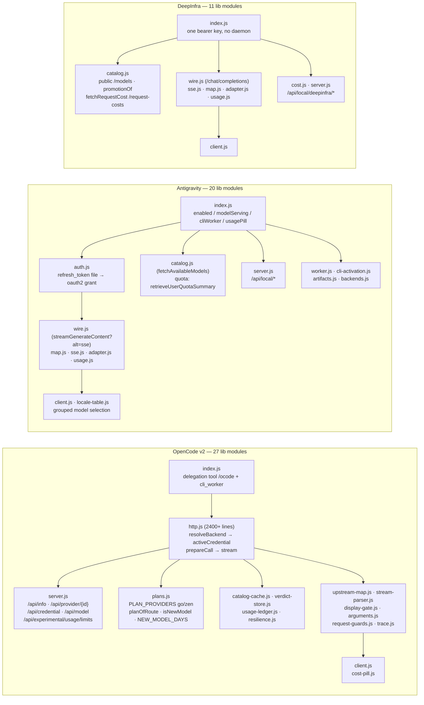
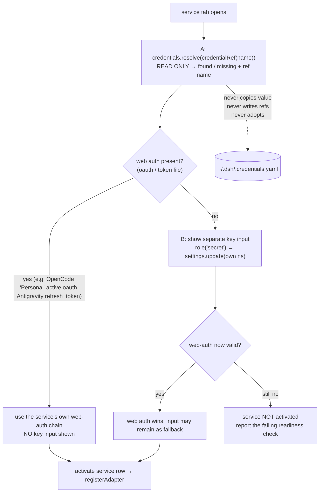
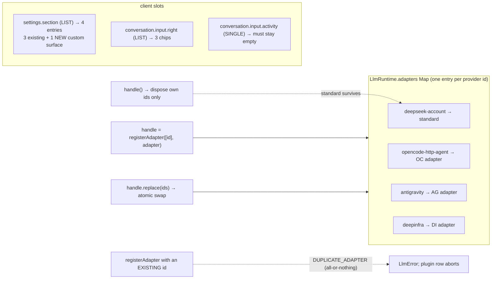

# Custom Router — Standardised Architecture and Composition Diagrams

<!-- skeleton:
version: 0.0.1-rc.1
kind: spec
status: active
updated: 2026-11-06
summary: The missing composition diagrams and normative per-service module contract for the three custom routers, the new Settings-Models (Custom) surface, and credential/readiness decision flow.
-->

> Status: **specification only.** Produced because the owner pointed out that the previous
> rounds wrote "명세화·규격화" without ever showing a composition diagram. Every node below is a
> **measured module, registration, slot, or HTTP route** from the installed runtime and the three
> plugin tracks (2026-11-06, DSH `0.2.2-rc.1`). No code, live profile, or version was changed;
> this document starts at `0.0.1-rc1` and no `rc#` was advanced.
> Companion specs: [CUSTOM-ROUTER-SERVICE-SPEC.md](./CUSTOM-ROUTER-SERVICE-SPEC.md),
> [CUSTOM-ROUTER-PROTOCOL-STANDARD.md](./CUSTOM-ROUTER-PROTOCOL-STANDARD.md),
> [CUSTOM-ROUTER-PRESET-SURFACE.md](./CUSTOM-ROUTER-PRESET-SURFACE.md).

## 1. Why this document exists

"규격화" means a future agent can add a fourth service **without re-deriving the shape**. The
previous specs described behaviour in prose but never drew the composition or pinned the module
contract. This document supplies both: **§2 diagrams** (what connects to what) and **§3 the
normative per-service module contract** (what each service must implement). Both are derived from
measurement, not design preference.

## 2. Composition diagrams

### 2.1 Overall architecture — standard runtime + 3 custom routers + new surface

```mermaid
flowchart TB
  subgraph HOST["DSH host (installed 0.2.2-rc.1) — untouched"]
    LLM["dsh-llm / LlmRuntime<br/>registerAdapter · directory · discoveries<br/>adapters Map · dispose/replace"]
    CRED["dsh-credentials-local<br/>~/.dsh/.credentials.yaml<br/>refs: / records:"]
    SETTINGS["dsh-client-ui-settings<br/>settings.section (LIST slot)"]
    COMPOSER["dsh-client-ui-conversation<br/>conversation.input.right (LIST slot)"]
    STD["standard routes<br/>deepseek-account (live)<br/>llm-pi-ai (disabled / dormant)"]
    MODELS["standard Settings → Models<br/>flat rowCard section (NO tab API)"]
  end

  subgraph SURFACE["NEW: Settings-Models (Custom) — plugin-owned settings.section"]
    TABS["tab strip (plugin React state)<br/>OpenCode v2 | Antigravity | DeepInfra"]
    READ["A: read-only key reference<br/>credentialRef → resolve → found/missing"]
    INPUT["B: separate key input<br/>role('secret') + settings.update<br/>(only when web auth absent)"]
    CHECK["per-tab readiness + plan/catalog checks"]
  end

  subgraph OC["@nolit/dsh-opencode-v2 (0.0.1-rc.1)"]
    OCID["route: opencode-http-agent"]
    OCSRV["lib/http.js · lib/server.js<br/>control plane /api/provider /api/credential /api/model<br/>+ /chat/completions direct"]
    OCCLI["lib/client.js<br/>settings.section + input.right"]
    OCSUB["lib/index.js · lib/subagent.js<br/>registerProvider('opencode')"]
  end

  subgraph AG["@nolit/dsh-antigravity (0.0.1-rc.7)"]
    AGID["route: antigravity"]
    AGMOD["lib/adapter.js · auth.js · wire.js<br/>catalog.js · server.js · map.js · sse.js"]
    AGCLI["lib/client.js<br/>settings.section + input.right"]
    AGSUB["lib/index.js · lib/subagent.js<br/>registerProvider('antigravity')"]
  end

  subgraph DI["@nolit/dsh-deepinfra (0.0.1-rc.8)"]
    DIID["route: deepinfra"]
    DIMOD["lib/adapter.js · catalog.js · cost.js<br/>wire.js · sse.js · server.js"]
    DICLI["lib/client.js<br/>settings.section + input.right"]
  end

  TABS --> CHECK --> OC & AG & DI
  READ -. "reads hint only, never writes" .-> CRED
  INPUT -. "writes own namespace only" .-> SETTINGS
  SURFACE -. "injected as ONE list entry" .-> SETTINGS
  STD --> LLM
  OCID --> LLM
  AGID --> LLM
  DIID --> LLM
  OCSRV --> OCID
  AGMOD --> AGID
  DIMOD --> DIID
  OCCLI --> SETTINGS & COMPOSER
  AGCLI --> SETTINGS & COMPOSER
  DICLI --> SETTINGS & COMPOSER
  OCSUB --> LLM
  AGSUB --> LLM
  MODELS -. "unchanged, row-based" .-> SETTINGS
```

**Measured anchors:** `registerAdapter` at `dsh-llm/lib/index.js:1842` (all-or-nothing,
`DUPLICATE_ADAPTER` at :1872); `settings.section` injections at
`dsh-opencode-v2/lib/client.js:981`, `dsh-antigravity/lib/client.js:491`,
`dsh-deepinfra/lib/client.js:717`; `conversation.input.right` at :975 / :496 / :712;
standard Models page has no `registerTab` API (measured 0 hits).

### 2.2 Per-service internal composition (the "각각의 커스텀된 것" the owner asked for)

**What is customised per service (measured, not generic):**

| Layer | OpenCode v2 | Antigravity | DeepInfra |
| :--- | :--- | :--- | :--- |
| Wire | OpenAI `/chat/completions` | Google `/v1internal:streamGenerateContent?alt=sse` | OpenAI `/chat/completions` |
| Control plane | local `opencode serve` daemon | `cloudcode-pa` + `daily-cloudcode-pa` (2 hosts) | none |
| Auth chain | `apiKey` → `OPENCODE_API_KEY` → `/api/credential` (oauth > key) | token file `refresh_token` → OAuth refresh; **no key path** | UI secret → `DEEPINFRA_API_KEY` |
| Catalog | control plane + durable cache + `data/index.json` ranking | `fetchAvailableModels` + quota, 15-min TTL | public `/models`, 30-min TTL, 178 entries / 92 chat routes |
| Plan / promotion | `go|zen` prefix + `NEW_MODEL_DAYS=7` + New badge | weekly / 5h quota buckets | `metadata.discount` 8/92 + `/v1/request-costs` |
| Usage | `session export` / usage limits, disjoint buckets | response usage + quota summary | trailing SSE usage chunk + exact cost |
| Cost | reported / ledger + cost pill | account quota | **derived locally, labelled estimated** |
| Local API | — | `/api/local/*` | `/api/local/deepinfra/*` |
| Extra surfaces | `opencode` tool, `/ocode`, `cli_worker`, `subagent_opencode` | `/agy`, `agy_worker`, `subagent_antigravity` | none (pure fetch) |

### 2.3 Credential decision flow (owner decision 2, read-only)

Measured grounds: `dsh-opencode-v2/lib/http.js:1180–1183` (apiKey → env → `activeCredential`),
`dsh-antigravity/lib/auth.js:27–46` (token file → `AuthError NO_CREDENTIAL`),
`dsh-deepinfra/lib/settings.js:67–79` (UI → env → none), and the live
`GET /api/credential` result (`Personal` oauth active, two keys inactive).

### 2.4 Registration and slot contract (why coexistence is possible)

Real-mount proof (parent spec §2): isolated A/B boots, 81 entries, 0 `did not activate`,
0 page errors; S2/S4/S5/S7 executed against the real `LlmRuntime`.

## 3. Normative per-service module contract (the standardisation)

A fourth service is conformant only when it supplies **all** of the following. Each row is a
contract, not a suggestion; the "measured in" column names the existing implementation that
proves the shape.

| # | Required module / capability | Interface | Measured in |
| :--- | :--- | :--- | :--- |
| M1 | entry `apply(ctx, config)` | registers exactly one provider id with `ctx.llm.registerAdapter([id], adapter)`; holds the disposer | all 3 `lib/index.js` / `http.js:2408` |
| M2 | `LlmAdapter` subclass | `providerInfo`, `listModels`, `resolveModel`, `prepareCall`, `stream(): AsyncIterable<StreamChunk>`; `attributionHeaders()` | `adapter.js` in all 3 |
| M3 | wire + SSE mapper | maps provider deltas into `text-delta / reasoning-delta / tool-call-delta(argumentsDelta) / usage / finish`; `usage` before `finish`, nothing after. **One shared implementation with hooks** — [SHARED-STREAM-PIPE-SPEC.md](./SHARED-STREAM-PIPE-SPEC.md) | `dsh-custom-router/lib/stream` (target); today `wire.js`+`sse.js`+`map.js`+`adapter.js` per service |
| M4 | credential resolver | explicit precedence chain, `role('secret')` for typed keys, no ad-hoc key files where a settings field exists | `settings.js` / `auth.js` / `http.js:1180` |
| M5 | catalog source | live or TTL-cached, provider-owned; publishes model ids, context, reasoning, capabilities | `catalog.js` / `catalog-cache.js` |
| M6 | service-specific facts | plan / quota / promotion / cost — the three gaps the standard does not serve | `plans.js`, `quotaSummary()`, `promotionOf()`, `cost.js` |
| M7 | local API surface (if needed) | `/api/local/<service>/*` registered via `ctx.effect`, disposed on unload | `server.js` in AG + DI |
| M8 | client half | one `settings.section` + one `conversation.input.right` entry, provider-id gated, live typography tokens | 3 `client.js` files; [PLUGIN-STYLE-STANDARD.md](../../docs/PLUGIN-STYLE-STANDARD.md) |
| M9 | readiness probe | per-service install/web-auth check chain (§2.3), pass/fail, no silent default | [CUSTOM-ROUTER-PRESET-SURFACE.md §3.3](./CUSTOM-ROUTER-PRESET-SURFACE.md) |
| M10 | per-service preset tab | one tab in the new custom surface = one tool; add → activate, remove → dispose | [CUSTOM-ROUTER-PRESET-SURFACE.md §3.2](./CUSTOM-ROUTER-PRESET-SURFACE.md) |
| M11 | history | `CHANGELOG.md` with measured before/after | RULES.md §6.1 |
| M12 | version | `0.0.1-rc1` start; `rc#` only by owner instruction | global AGENTS.md §6 |

### 3.1 The standardisation rule

**Shared (never re-derived):** M1–M3 (registration + `LlmAdapter` + `StreamChunk`), M8 slot
shape, M11–M12 version/history.
**Customised (declared per service, never merged into one adapter):** M4 credential chain, M5
catalog source, M6 service-specific facts, M7 local API, M9 readiness probe, M10 preset tab.

This is the answer to "각 서비스별 로직이나 각각의 커스텀된 거 규격화": the **contract is one**,
the **implementations are per-service**, and the boundary between them is the table above. The
decommissioned `dsh-subrouter` failed because it duplicated M2/M3 beside the harness; the
three current plugins succeed because they implement M2/M3 **inside** it.

## 4. Verification of this document

| Check | Command | Expected |
| :--- | :--- | :--- |
| Every node exists | `ls dsh-*/lib/*.js`, `grep registerAdapter dsh-*/lib/index.js dsh-opencode-v2/lib/http.js` | the three provider ids |
| Slots | `grep -rn "slots.inject" dsh-*/lib/client*.js` | `settings.section` + `conversation.input.right` only |
| Standard tab API absent | `grep -rn "registerTab\|addTab" .../dsh-client-ui-settings/lib` | 0 hits |
| Gates | `npm run docs:check` | indexed, no stale |

## 5. Not done here

- No implementation of the new surface, no `settings.section` row written, no live-profile edit,
  no restart, no browser boot of a new surface, no real generation turn.
- Which track owns the surface, and when implementation is approved — owner decisions.
- Any version or rc-number change.

## 6. References

- [PRESET-SCHEMA-AND-EXTENSION.md](./PRESET-SCHEMA-AND-EXTENSION.md) — per-service preset schema, extension limits, future-service coverage tiers

- [CUSTOM-ROUTER-SERVICE-SPEC.md](./CUSTOM-ROUTER-SERVICE-SPEC.md), [CUSTOM-ROUTER-PROTOCOL-STANDARD.md](./CUSTOM-ROUTER-PROTOCOL-STANDARD.md), [CUSTOM-ROUTER-PRESET-SURFACE.md](./CUSTOM-ROUTER-PRESET-SURFACE.md)
- [UI-SLOT-ARCHITECTURE.md](../../docs/UI-SLOT-ARCHITECTURE.md), [PLUGIN-STYLE-STANDARD.md](../../docs/PLUGIN-STYLE-STANDARD.md), [RULES.md](../../docs/RULES.md)
- [dsh-opencode-v2/docs/OPENCODE-V2-HTTP-API-MEASUREMENT.md](../../archive/dsh-opencode-v2/docs/OPENCODE-V2-HTTP-API-MEASUREMENT.md), [FAILURE-LEDGER.md](../../docs/FAILURE-LEDGER.md)

## Cross-reference

- [WEB-AUTH-PIPELINE-ENGINE.md](./WEB-AUTH-PIPELINE-ENGINE.md) — upper/lower web-auth ownership; standard vs per-service layer verdict
