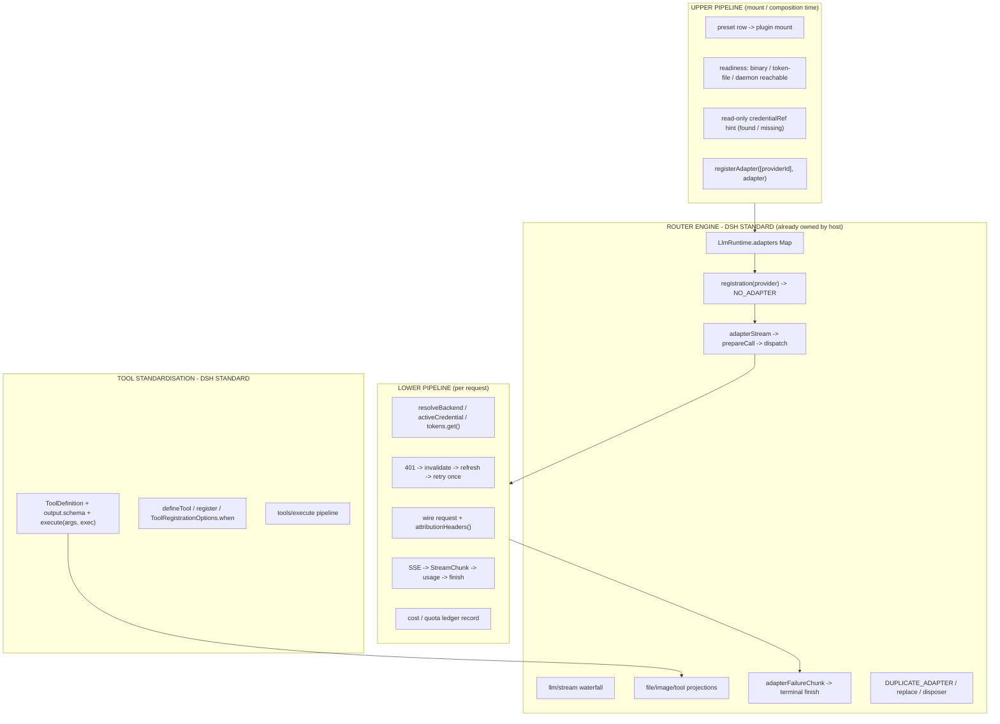

# Custom Router — Web-Auth Pipeline Ownership and Router-Engine Standardisation

<!-- skeleton:
version: 0.0.1-rc.1
kind: spec
status: active
updated: 2026-11-06
summary: Answers whether upper/lower pipelines, model serving, tool standardisation and router-engine logic can be standardised, or stay per-service: measured layer-ownership split.
-->

> Status: **specification built on measurement**, 2026-11-06, DSH `0.2.2-rc.1`. The owner
> asked: for web auth, can the **upper pipeline**, **lower pipeline**, **model serving**,
> **tool-standardisation**, and **router-engine logic** all be standard-spec'd, or does each
> service preset just manage them? The measured answer is **neither/or**: it is a **layer split**.
> Document version follows the `rc.#` history scheme; plugin `@nolit/dsh-custom-router` is
> `0.0.1-rc.1`. No `rc#` advanced, no code/profile/version changed.
> Parents: [CUSTOM-ROUTER-ARCHITECTURE.md](./CUSTOM-ROUTER-ARCHITECTURE.md),
> [PRESET-SCHEMA-AND-EXTENSION.md](./PRESET-SCHEMA-AND-EXTENSION.md),
> [CUSTOM-ROUTER-PRESET-SURFACE.md](./CUSTOM-ROUTER-PRESET-SURFACE.md).

## 1. The question, restated from measurement

## 2. Measured: where web auth actually lives

| Where | Measured call site | What it does |
| :--- | :--- | :--- |
| **Upper (mount)** | `dsh-antigravity/lib/index.js:374` `new TokenProvider({config, fetchImpl, log})` built once at `apply()`; `catalog` created with the same `tokens` (`:382-406`) | constructs the token provider and wires it into the adapter — **does not perform a login**. `tokenFile`/`refreshToken` are Config fields only. |
| **Upper (preset)** | [PRESET-SURFACE §1.2](./CUSTOM-ROUTER-PRESET-SURFACE.md), owner decision 2 | `credentials.resolve(credentialRef(name))` -> **found/missing report only**; no copy, no write. Readiness checklist checks the binary/daemon/token-file **exists**. |
| **Lower (request)** | `dsh-antigravity/lib/auth.js:105` `accessToken()` -> `refresh()` -> `oauth2.googleapis.com/token`; `lib/index.js:198-202` `authorization: Bearer ${token}` on `loadCodeAssist`; `lib/adapter.js:255-260` **401 -> `tokens.invalidate()` -> refresh -> retry once** | the actual token is minted/refreshed **per request**, with one retry on expiry. |
| **Lower (request)** | `dsh-opencode-v2/lib/http.js:1806` `resolveBackend()` inside `stream()`; `:1180-1183` `apiKey -> apiKeyEnv -> activeCredential(oauth>key)`; `:1873,1886` `force:true` on 401 | same shape: credential resolved lazily at dispatch, refreshed on 401, never at mount. |
| **Lower (DeepInfra)** | `lib/settings.js:67-79` UI secret -> env -> none | no web auth; a bearer key is read per request. |

**Conclusion:** web auth is **already split across both pipelines**, and that split is the correct
one. The preset's job is only the upper, read-only part (is the credential source available?).
The lower part (mint/refresh/retry) belongs to the service's **adapter**, because only the adapter
knows the token endpoint, the expiry skew, the `invalid_grant` semantics, and the 401 body.
Putting a live OAuth refresh in the preset would (a) run it without a request, (b) duplicate the
adapter's cache/inflight lock, and (c) break the measured "refresh once on 401" contract.

## 3. Verdict table — standard spec vs per-service preset

| Layer | Standardised? | Owner | Measured ground |
| :--- | :--- | :--- | :--- |
| **Upper pipeline** (mount, readiness, read-only key reference, row insertion) | **YES — one shared spec** | `ServicePreset` / the new custom surface | `AgentPreset.Config`, `settings.section` list, `credentials.resolve`, S1-S9 in [PRESET-SCHEMA](./PRESET-SCHEMA-AND-EXTENSION.md) |
| **Lower pipeline** (per-request credential resolution, refresh, 401 retry, SSE->StreamChunk, usage/cost record) | **Contract YES, implementation per service** | shared `LlmAdapter`/`StreamChunk` contract; each service's adapter implements it | `prepareCall` `adapterStream` `types.d.ts`; `auth.js` / `http.js:1806` / `cost.js` |
| **Model serving** (wire family, endpoint, catalog, reasoning mapping) | **Contract YES, implementation per service** | `LlmAdapter` + `StreamChunk` + M1-M12 | [PROTOCOL §2](./CUSTOM-ROUTER-PROTOCOL-STANDARD.md), [ARCHITECTURE §3](./CUSTOM-ROUTER-ARCHITECTURE.md) |
| **Tool standardisation** | **YES — already standard in DSH** | `@deepseek-ai/dsh-tools` | `ToolDefinition` (`output.schema` + `output.render` + `execute(args, exec)`), `defineTool`, `register(def, {when})`, `tools/execute` pipeline |
| **Router engine logic** (provider registry, dispatch, duplicate guard, atomic replacement, terminal failure, projections) | **YES — entirely standard, do NOT re-implement** | `@deepseek-ai/dsh-llm LlmRuntime` | `registerAdapter` 1842, `prepareRoutes` 1867, `commitRoutes` 1895, `registration` 2267, `adapterStream` 2314, `llm/stream` waterfall |
| **Subscription plan / usage / promotion / quota** | **NO — custom surface only** | this track | [PLAN-AND-USAGE-SPEC.md](./PLAN-AND-USAGE-SPEC.md); standard zeroes cost, freezes catalog |

**One-line answer:** 상단 파이프라인·도구 규격·라우터 엔진은 **표준 규격이 가능하고 이미 표준이 있다**
(우리가 만드는 건 그 위의 얇은 편성 레이어뿐). 하단 파이프라인·모델서빙은 **계약은 표준, 구현은
서비스별**이다. 그리고 플랜/사용량/할인만 **프리셋(커스텀 surface)이 단독 소유**한다.
"그냥 각 서비스 프리셋에서 관리"는 **마지막 한 줄에만** 해당한다.

## 4. Why the router engine must NOT be re-standardised here

Measured in `dsh-llm/lib/index.js`:

- `registerAdapter` (1842) is all-or-nothing; `prepareRoutes` throws `DUPLICATE_ADAPTER`
  (1872); `commitRoutes` (1895) swaps the route set in one synchronous section.
- `adapterStream` (2314) selects the registration, calls `prepareCall`, resolves the call
  config, projects **files -> text**, **images for text-only models**, **tool updates**, then
  dispatches; any adapter/dispatch failure becomes one `adapterFailureChunk` (terminal `finish`).
- `llm/stream` is a **waterfall** (`types/index.d.ts:45`) — middleware can wrap a call.
- `registration(provider)` (2267) throws `NO_ADAPTER` when a route was dropped.

A second "router engine" inside `dsh-custom-router` would duplicate exactly this and break the
measured coexistence proof (S1-S8 in the parent spec). This is the `dsh-subrouter` failure
recorded in [dsh-opencode-v2/docs/OPENCODE-MODEL-SERVING-PLAN.md](../../dsh-opencode-v2/docs/OPENCODE-MODEL-SERVING-PLAN.md): it sat
*beside* the harness and lost retry, attribution, and discovery. **Rule R0: the custom router
uses `ctx.llm.registerAdapter`; it never owns a second routing table.**

## 5. The thin standard layer this track actually adds

Because DSH already owns the engine, `dsh-custom-router` contributes only three things:

| # | Contribution | Boundary |
| :--- | :--- | :--- |
| C1 | `ServicePreset` descriptor + `settings.section` tab strip | upper pipeline only; no request-time state |
| C2 | `PlanVerdict` / `UsageReading` normalisation | reads each service's own local API; never asks the host |
| C3 | read-only credential reference + readiness checklist | reports; never mints a token, never writes `refs` |

Everything below the `registerAdapter` line stays in the three vendor packages. The **tool
standardisation** is likewise not re-invented: each service's `/ocode`, `/agy` `agy_worker`,
`cli_worker` already register `ToolDefinition`s with `output` + `defineTool` (measured in
[DSH-RC1-PLUGIN-DELTA.md](../../docs/DSH-RC1-PLUGIN-DELTA.md) item 6). The preset only decides
**which of those tools a session sees**.

## 6. Web-auth normative rules (web auth vs key input)

| # | Rule |
| :--- | :--- |
| W1 | Upper pipeline performs **existence/readiness only** — never a live OAuth grant. |
| W2 | Lower pipeline owns token minting, caching (`inflight`, `EXPIRY_SKEW_MS`), `invalid_grant`, and **one** 401 refresh+retry. |
| W3 | A preset may show a separate `role('secret')` key input **only when web auth is absent** (owner decision 2); a present web auth always wins. |
| W4 | Antigravity has **no key path** (`GEMINI_API_KEY` does not authenticate); its preset must not render a key field at all. |
| W5 | OpenCode go uses active oauth (`Personal`) with no typed key; `credentialLabel` pinning is the only reason to show a key. |
| W6 | DeepInfra has no web auth; its key is the primary credential, read per request (UI -> env -> none). |
| W7 | A failed lower-pipeline auth surfaces as a terminal `finish{kind:'error'}` / `LlmError`, never as a blank chip or a fabricated 0. |
| W8 | `ToolRegistrationOptions.when` is the only conditional activation seam; do not invent a second one in the preset. |

## 7. Coverage of the owner's five nouns

| Owner noun | Standard spec possible? | Managed by preset? |
| :--- | :--- | :--- |
| 상단 파이프라인 | YES shared `ServicePreset` | YES (declares it) |
| 하단 파이프라인 | YES shared `LlmAdapter`/`StreamChunk` contract | NO (adapter implements) |
| 모델서빙 | YES shared M1-M12 contract | NO (adapter implements) |
| 도구 규격화 | YES already `ToolDefinition` standard | YES (selects which tools) |
| 라우터 엔진 로직 | YES entirely `LlmRuntime` | **NO (never — R0)** |
| 플랜·사용량·할인 (implicit) | NO | YES sole owner |

## 8. Verification of this document

| Claim | Source |
| :--- | :--- |
| web auth minted per request | `dsh-antigravity/lib/auth.js:105-162`, `http.js:1806` |
| 401 refresh once | `dsh-antigravity/lib/adapter.js:255-260`, `http.js:1873` |
| engine already standard | `dsh-llm/lib/index.js:1842,2314`; `types/index.d.ts:45` |
| tool standard | `dsh-tools/lib/types/contracts.d.ts:23-70` |
| `NO_ADAPTER` on dropped route | `dsh-llm/lib/index.js:2267` |

## 9. Not done here

No descriptor implementation, no `settings.section` row, no tool registered, no real mount,
no browser boot, no generation turn, no version/rc change.

## 10. References

- [CUSTOM-ROUTER-SERVICE-SPEC.md](./CUSTOM-ROUTER-SERVICE-SPEC.md), [CUSTOM-ROUTER-ARCHITECTURE.md](./CUSTOM-ROUTER-ARCHITECTURE.md), [CUSTOM-ROUTER-PROTOCOL-STANDARD.md](./CUSTOM-ROUTER-PROTOCOL-STANDARD.md), [CUSTOM-ROUTER-PRESET-SURFACE.md](./CUSTOM-ROUTER-PRESET-SURFACE.md), [PLAN-AND-USAGE-SPEC.md](./PLAN-AND-USAGE-SPEC.md), [PRESET-SCHEMA-AND-EXTENSION.md](./PRESET-SCHEMA-AND-EXTENSION.md)
- [dsh-opencode-v2/docs/OPENCODE-MODEL-SERVING-PLAN.md](../../dsh-opencode-v2/docs/OPENCODE-MODEL-SERVING-PLAN.md), [docs/RULES.md](../../docs/RULES.md), [docs/DSH-RC1-PLUGIN-DELTA.md](../../docs/DSH-RC1-PLUGIN-DELTA.md)
